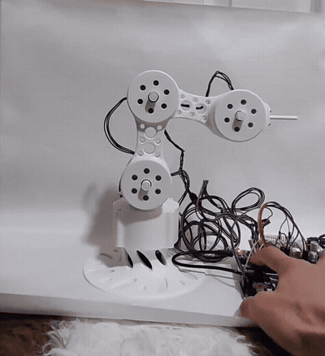
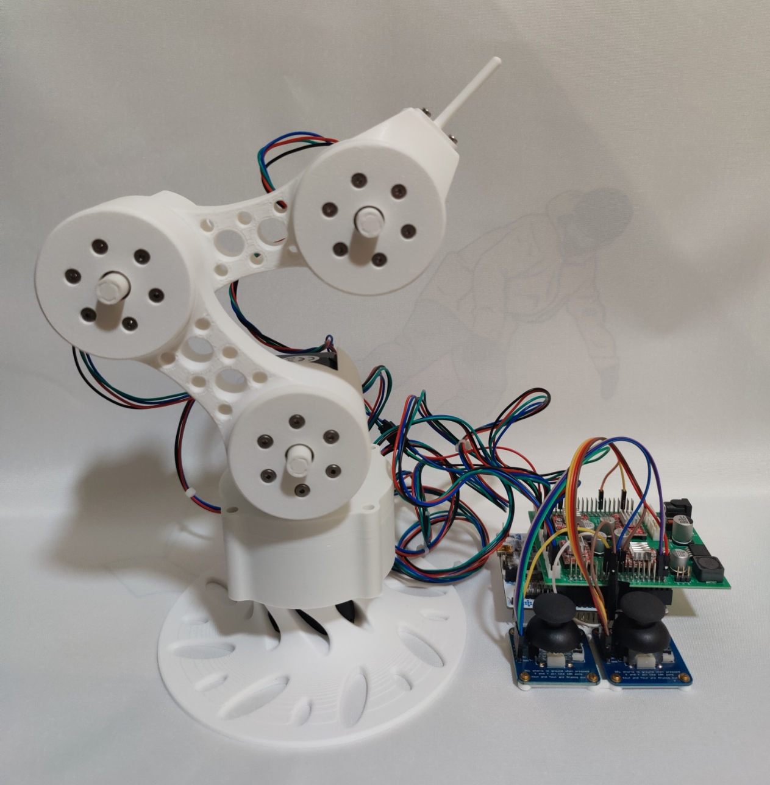
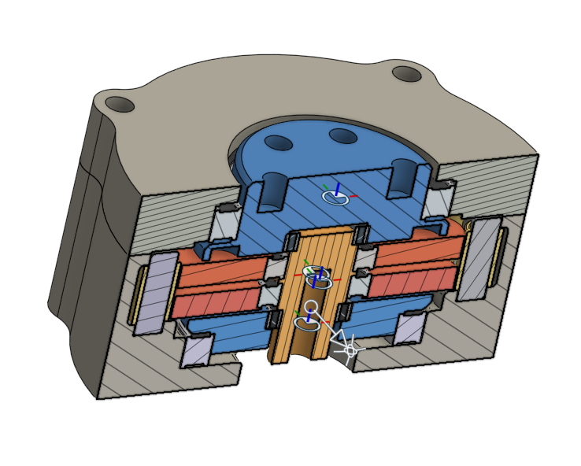
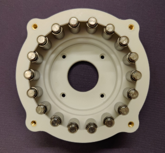
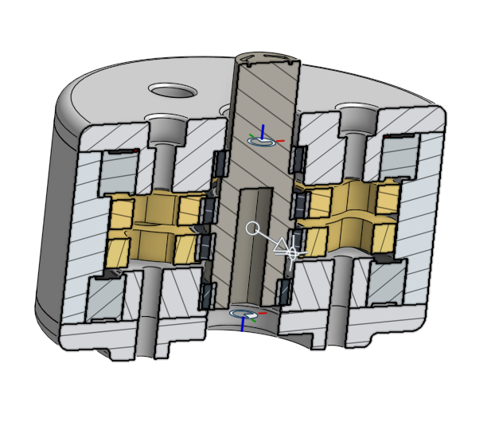
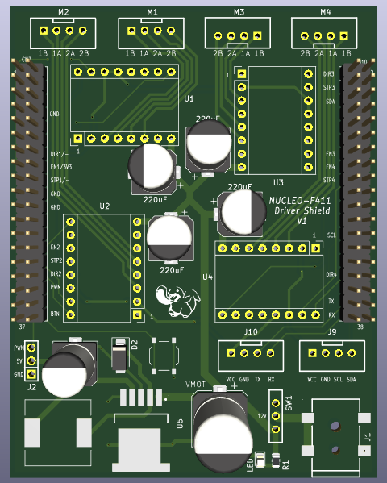
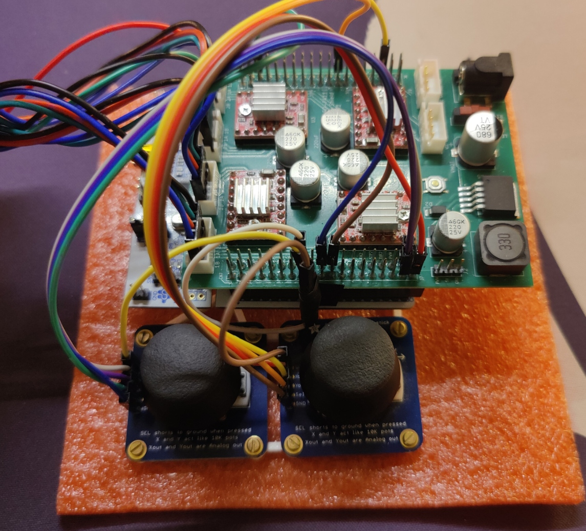
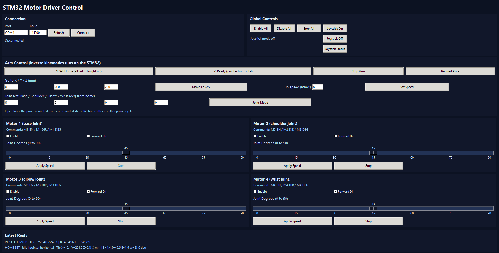

# 4-DOF Robotic Arm Controller with On-Chip Inverse Kinematics

A 4-degree-of-freedom robotic manipulator powered by an **STM32F411RE (ARM Cortex-M4 @ 100 MHz)** microcontroller. The system features real-time on-chip analytical inverse kinematics (IK) for 3D Cartesian teleoperation, an interrupt-driven multi-axis stepper motion engine, custom 3D-printed cycloidal speed reducers, a custom-designed PCB motor shield, and a Python-based telemetry and control GUI.

<p align="center">
  
  
</p>

<p align="center">
  <a href="https://youtube.com/shorts/Uywyl2mFVd8"><b>Watch Full 50s Demonstration Video (YouTube)</b></a> &nbsp;|&nbsp;
  <a href="https://cad.onshape.com/documents/2ba6d4e9a37a8a971efb751c/w/63f305e31705ebf14d42ed68/e/8a7756ceea2622c2801c4764?renderMode=0&uiState=6acdd42651f57ab03b341d4e"><b>Base Cycloidal CAD (Onshape)</b></a> &nbsp;|&nbsp;
  <a href="https://cad.onshape.com/documents/21856b5a57df7f60c8bb5711/w/d83e96e5db2e67aef034e94f/e/6f31f0688cf59660987a114f?renderMode=0&uiState=6acdd44ba3517403a6dbd75b"><b>Compact Drive CAD (Onshape)</b></a>
</p>

---

## Key Highlights

- **Real-Time On-Chip Inverse Kinematics:** Computes closed-form analytical geometric IK and forward kinematics directly in embedded C on the MCU (< 1 ms per cycle), enforcing joint angle limits and table surface collision safety.
- **End-Effector Orientation Control:** Automatically coordinates shoulder, elbow, and wrist joints to maintain a constant horizontal pitch (90° relative to vertical) throughout multi-axis Cartesian translations.
- **Custom Transmission:** Driven by NEMA 17 stepper motors through custom 3D-printed cycloidal gear reducers (**17:1** base rotation, **25:1** shoulder, elbow, and wrist joints) for high reduction ratio and low backlash in a compact form factor.
- **Custom PCB Driver Shield:** Designed a custom 4-axis stepper driver expansion shield mating directly with the STM32 Nucleo-64 morpho headers, featuring bulk filtering capacitance, dedicated logic routing, and analog joystick breakouts.
- **Cartesian Joystick Teleoperation:** Dual 2-axis analog joysticks with center-voltage auto-calibration, deadband shaping, and directional cross-talk suppression to isolate pure base sweeps from reach/elevation.
- **Motion Engine:** Paced timer PWM pulse-burst generator synchronizing all 4 axes with joint rate limits and configurable tip speeds up to 60 mm/s.
- **Host Telemetry GUI:** Multithreaded Python/Tkinter application streaming live joint angles, Cartesian coordinates (X, Y, Z), and motor states over 115,200 baud UART.

---

## Mechanical Design & Cycloidal Transmission

The arm utilizes custom 3D-printed cycloidal speed reducers designed from scratch in Onshape. Cycloidal drives provide high reduction ratios in a single stage, compact radial geometry, and superior backlash characteristics compared to traditional spur or planetary gearboxes.

| Base Drive (17:1) Section View | Base Drive Housing & Pin Rollers | Compact Drive (25:1) Section View |
| :---: | :---: | :---: |
|  |  |  |
| *Single-stage 17:1 reduction with central bore for wiring and output thrust bearings.* | *Physical 3D-printed housing with 18 precision pin rollers and brass heat-set threaded inserts.* | *Dual 180°-offset cycloidal discs for dynamic vibration balancing on arm joints.* |

- **Base Joint (17:1):** Single-stage cycloidal reduction with 18 ring pins and a 17-lobe cycloidal disc. [Inspect Base CAD Model](https://cad.onshape.com/documents/2ba6d4e9a37a8a971efb751c/w/63f305e31705ebf14d42ed68/e/8a7756ceea2622c2801c4764?renderMode=0&uiState=6acdd42651f57ab03b341d4e).
- **Shoulder, Elbow, & Wrist (25:1):** Compact dual-disc cycloidal drives with 180° phase offset to cancel eccentric radial forces and minimize joint vibration. [Inspect Compact CAD Model](https://cad.onshape.com/documents/21856b5a57df7f60c8bb5711/w/d83e96e5db2e67aef034e94f/e/6f31f0688cf59660987a114f?renderMode=0&uiState=6acdd44ba3517403a6dbd75b).

---

## Electronics & Custom Driver Shield

To eliminate point-to-point breadboard wiring and provide clean power distribution, a dedicated 4-axis stepper controller shield was designed to stack directly onto the STM32 Nucleo-64 board.

| Custom PCB Shield (CAD Render) | Physical Controller & Joystick Stack |
| :---: | :---: |
|  |  |
| *Custom 2-layer PCB designed in KiCad, integrating 4x A4988 driver sockets, motor output terminals, and bulk filter capacitors.* | *Assembled hardware stack with heatsinked A4988 modules, custom wiring harness, and dual thumbsticks.* |

- **Driver ICs:** 4x Allegro A4988 stepper driver modules with tuned current reference voltages (Vref).
- **Power Decoupling:** Dedicated 220 µF low-ESR electrolytic capacitors on each motor power rail (VMOT) to suppress inductive switching transients.
- **Analog Joystick Breakout:** 4 analog ADC channels routed from Nucleo pins PC1–PC4 for Left/Right dual-axis thumbsticks.

---

## Host Control GUI

A custom desktop application built in Python/Tkinter provides real-time telemetry, calibration, and manual jogging over an asynchronous 115,200 baud serial connection.

<p align="center">
  
</p>

- **Cartesian Control:** Absolute Cartesian coordinate input (X, Y, Z in millimeters) with automatic IK trajectory generation.
- **Joint Testing:** Direct joint-angle jogging and individual axis calibration.
- **Live Pose Feedback:** Streams live computed Cartesian positions (X, Y, Z), joint angles, and homing status via periodic `POSE` packets.

---

## Hardware Specifications

| Component | Specification | Description |
| :--- | :--- | :--- |
| **Microcontroller** | STM32F411RE (Nucleo-64) | ARM Cortex-M4 @ 100 MHz, 512 KB Flash, 128 KB SRAM |
| **Motor Drivers** | 4x Allegro A4988 | Custom-wired shield plugged into Nucleo CN7/CN10 headers |
| **Motors (M1 - M3)** | NEMA 17 (`17HS16-2004S1`) | 45 Ncm holding torque, 2.0A rated, open-loop |
| **Motor (M4 - Wrist)** | NEMA 17 Pancake (`17HS08-1004S`) | 16 Ncm holding torque, 1.0A rated, low-mass wrist joint |
| **Gear Reducers** | 3D-Printed Cycloidal Drives | Base: 17:1 ratio; Shoulder/Elbow/Wrist: 25:1 ratio |
| **Analog Inputs** | 2x Dual-Axis Analog Joysticks | 4x ADC channels (12-bit ADC1 on PC1–PC4) |
| **Link Dimensions** | Base-to-Shoulder: 121 mm<br>L1 (Shoulder–Elbow): 100 mm<br>L2 (Elbow–Wrist): 100 mm<br>End-Effector (Pointer): 100 mm | Total horizontal reach: ~300 mm |

---

## System Architecture

```text
       +-----------------------+
       |   Dual Analog Sticks  |
       |  (Left: Z | Right: XY)|
       +-----------+-----------+
                   | (ADC1 Ch11-Ch14)
                   v
       +----------------------------------------------------+
       |                  STM32F411RE MCU                   |
       |                                                    |
       |  1. Analog Signal Conditioning & Cross-Talk Filter |
       |  2. Closed-Form Analytical Inverse Kinematics     |
       |  3. Joint Limit & Collision Protection             |
       |  4. Timer PWM Pulse-Burst Motion Generator         |
       +-------------------+--------------------------------+
                           |
            +--------------+--------------+
            | (STEP / DIR)                | (UART 115.2k Baud)
            v                             v
+-----------------------+     +-----------------------+
|  4x A4988 Drivers     |     |   Python Host GUI     |
|  & Cycloidal Motors   |     | (Tkinter Telemetry UI)|
+-----------------------+     +-----------------------+
```

---

## Kinematics Overview

### Coordinate Frame & Arm Geometry
- **Home Pose:** All linkages vertical, pointing straight up along +Z.
- **Z-Axis:** Vertical elevation above the resting table surface (Z_shoulder = 121 mm).
- **X/Y-Plane:** Horizontal plane swept by the base joint:
  ```text
  phi = atan2(-X, Y)
  ```
- **End-Effector Pitch:** Held horizontal at `theta1 + theta2 + theta3 = 90°`, solving wrist position from tip coordinates:
  ```text
  r_wrist = sqrt(X^2 + Y^2) - L_pointer
  z_wrist = Z - Z_shoulder
  ```
- **2-Link Arm IK:** Uses the law of cosines to find the elbow angle (beta) and shoulder angle (alpha) in the rotated arm plane, ensuring single-pass deterministic calculation without iterative solver divergence.

---

## Repository Structure

```text
.
├── Core/
│   ├── Inc/
│   │   ├── arm_kinematics.h      # Kinematic constants, structs, and function prototypes
│   │   ├── main.h                # Pin and peripheral definitions
│   │   └── ...
│   └── Src/
│       ├── arm_kinematics.c      # Analytical IK, FK, and joint-limit validation
│       ├── main.c                # Motion engine, joystick processing, UART packet parser
│       └── ...
├── Drivers/                      # STM32F4xx HAL and CMSIS driver libraries
├── .gitignore                    # Ignores build artifacts and virtual environments
├── CMakeLists.txt                # CMake build configuration
├── CMakePresets.json             # Build presets for VS Code CMake Tools
├── motor_control_gui.py          # Python Tkinter GUI for live telemetry & control
├── pin_connections.md            # Hardware pinout table (CN7 / CN10 headers)
├── requirements.txt              # Python dependencies
├── startup_stm32f411xe.s         # ARM Cortex-M4 startup assembly
├── STM32F411RETx_FLASH.ld        # Linker script
└── test_1.ioc                    # STM32CubeMX hardware configuration
```

---

## Getting Started

### 1. Prerequisites

- **Toolchain:** ARM GNU Toolchain (`arm-none-eabi-gcc`), `cmake`, and `ninja` (or [STM32CubeCLT](https://www.st.com/en/development-tools/stm32cubeclt.html)).
- **Programmer:** [STM32CubeProgrammer](https://www.st.com/en/development-tools/stm32cubeprog.html).
- **Python:** Python 3.10+ with `pyserial`.

### 2. Building and Flashing Firmware

1. Generate build files and compile:
   ```bash
   cmake -B build -G Ninja -DCMAKE_TOOLCHAIN_FILE=cmake/gcc-arm-none-eabi.cmake -DCMAKE_BUILD_TYPE=Debug
   cmake --build build
   ```

2. Flash to the STM32F411RE via ST-Link:
   ```bash
   STM32_Programmer_CLI -c port=SWD mode=UR freq=1000 -w build/test_1.elf -v -rst
   ```
   *(Note: `mode=UR` connects under reset, required when SWD pins share alternate functions).*

### 3. Running the Python GUI

1. Install Python dependencies:
   ```bash
   pip install -r requirements.txt
   ```

2. Launch the GUI:
   ```bash
   python motor_control_gui.py
   ```

3. Connect to the board's COM port (default baud: `115200`).
4. **Calibration sequence:**
   - Align all arm linkages vertically straight up.
   - Click **1. Set Home (Calibrate 0)**.
   - Click **Enable All** to energize the stepper motors.
   - Click **2. Ready Pose** to transition the arm into its horizontal ready stance.
   - Click **Joystick On** to begin real-time Cartesian teleoperation.

---

## Serial Command Interface

The firmware implements an ASCII packet protocol over UART:

| Command | Description |
| :--- | :--- |
| `HOME` | Zeroes all joint step counters at the current physical vertical pose |
| `READY` | Smoothly interpolates joints to horizontal pointer stance (X = 0, Y = 200, Z = 200 mm) |
| `GOTO=X,Y,Z` | Moves end-effector tip to absolute Cartesian coordinate in millimeters |
| `JMOVE=B,S,E,W` | Moves all 4 joints to specified angles in degrees |
| `SPEED=v` | Sets linear Cartesian tip speed limit (1 to 60 mm/s) |
| `JOY=1` / `JOY=0` | Enables or disables analog joystick teleoperation |
| `JOY_STATUS` | Queries raw ADC readings and calibrated center values |
| `POSE` | Queries current computed Cartesian coordinates and joint angles |
| `STOP` | Immediately halts all motor motion |

---

## Author & License

Developed by Jonathan as part of an open-source robotics control project.
Licensed under the [MIT License](LICENSE).
